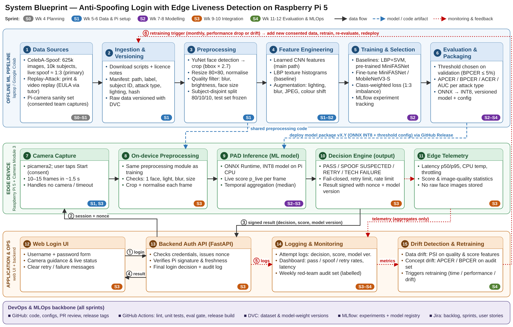

# Anti-Spoofing Login – Edge Liveness Detection on Raspberry Pi 5

COS40007 Artificial Intelligence Engineering – Group 3

A camera-based login check that tells a live person apart from a printed photo, a photo on a screen or a replayed video. The anti-spoofing model runs on a Raspberry Pi 5 with Camera Module 3; a web login page and a backend API combine its result with the password check.



## Repository structure

```
.github/workflows/   CI workflow (lint + tests); train and release workflows come in a later task
configs/             Versioned configuration (model version, threshold, preprocessing, retry limit)
data/                DVC pointers only – datasets and face images are never committed
docs/                Project documentation, architecture diagram, Jira import, task reports
  task1/             Group Task 1 – System Blueprint & Project Planning
src/preprocessing/   Shared preprocessing (used for training and on the Pi)
src/training/        Training and evaluation code
src/edge/            Raspberry Pi service: capture, inference, decision engine
src/backend/         Backend authentication API
web/                 Web login prototype
tests/               Automated tests
```

## Team

| Member | Roles |
|---|---|
| Dinh Phu Nguyen | Scrum Master, ML engineer, edge/embedded engineer, data, web/backend, QA, documentation, MLOps & DevOps lead |
| Phuc Lam Nguyen | Research and data support |

## Working rules

- `main` is protected: changes arrive through pull requests with one review and passing CI.
- Branch names and commit messages start with the Jira key, e.g. `feature/ASL-12-pi-capture`, `ASL-12: add picamera2 capture`.
- Releases are tagged `vMAJOR.MINOR.PATCH`.
- Never commit datasets, face images, model weights or secrets (see `.gitignore`). Data and weights are versioned with DVC.

## Links

- Jira board: https://group3-cos40007.atlassian.net/jira/software/projects/SCRUM/boards/1
- Project documentation: `docs/Project_Documentation.docx` (Markdown copy: `docs/project-documentation.md`)
- Group Task 1 report: `docs/task1/`
